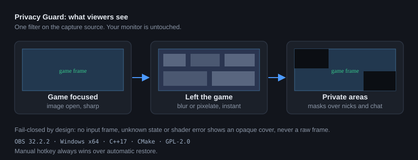

# OBS Privacy Guard

[](https://github.com/anteaterantibus-tech/OBS_Blur_out_of_Game/releases/latest)
[](LICENSE)
[](https://obsproject.com)
[](#requirements)
[](https://isocpp.org)

**Your game disappears from the stream the moment you leave it.** One filter on
your capture source hides the picture with blur, pixelation or an opaque cover
when the game loses focus, and keeps your nicknames and chat covered while you
play. Your own monitor is never touched: only the frame OBS sends to viewers
changes.



> Русская версия ниже: [Описание на русском](#obs-privacy-guard-русский)

---

## The problem it solves

You alt-tab to answer a message, and the stream shows your desktop, browser tabs
and notifications. Or a friend list pops up over the game with names you would
rather not show.

Privacy Guard is a native OBS Studio filter that watches which window has focus
and closes the captured image when it is not your game. It is fail-closed: any
doubt (no input frame, unknown process, shader error) shows the cover, never a
raw frame.

## Features

| Feature | Details |
|---|---|
| Auto-shutter | Closes instantly on focus loss, restores after a configurable delay (default 500 ms) |
| Three cover types | Gaussian blur, pixelation (mosaic), or opaque cover in any color |
| Fullscreen heuristic | Any exclusive or borderless fullscreen game works without listing its EXE |
| Process list | Add games with "+ EXE files", "+ Games folder" (recursive scan) or OBS hotkeys |
| Exceptions list | Browsers and video players never count as a game, so fullscreen video stays covered |
| Visibility rule | A fullscreen game on one monitor stays open when you click on another monitor |
| Manual shutter | OBS hotkey and button, always wins over automatic restore |
| Private areas | Up to 8 rectangles in percent of the source frame, blur or opaque, move with the source |
| Multi-game | Keep several games in the list and switch freely during a stream |
| Diagnostics | Status line with state, input frame size, game count and names; state transition log |
| Localized | Russian and English UI |

## Requirements

- Windows 10 or 11, x64
- OBS Studio **32.2.2** (Windows x64 build)
- No administrator rights needed, no anticheat interaction, no kernel drivers

## Install

1. Close OBS Studio.
2. Download `obs-privacy-guard-<version>-windows-x64-Setup.exe` from
   [Releases](https://github.com/anteaterantibus-tech/OBS_Blur_out_of_Game/releases/latest)
   and run it. The OBS folder is detected from the registry.
3. Start OBS, then right-click your capture source, **Filters**, **+**,
   **Privacy Guard**.

Portable OBS and manual installation are described in [INSTALL.md](INSTALL.md).

## Quick start

1. Right-click the source that shows your game, open **Filters**, add **Privacy Guard**.
2. In **Processes** add your game with "+ EXE files" or "+ Games folder".
   Fullscreen games need no setup at all.
3. In **Cover type** pick blur, pixelation or an opaque cover and set the strength.
4. Assign hotkeys in **Settings, Hotkeys, Privacy Guard**:
   toggle shutter, add active window, remove active window.
5. Add browsers to **Exceptions** so fullscreen video is never treated as a game.
6. Test with a **recording**, not only the preview: leave the game and check that
   viewers see the cover and not the desktop.

Detailed manual: [USER.md](USER.md) (Russian).

## Architecture

A single OBS filter (`OBS_SOURCE_TYPE_FILTER`) placed on the game or capture
source, not a separate source. Because it draws in the parent frame coordinates,
masks follow the source automatically when it is moved, scaled or cropped, and
`video_render` still runs when the input frame disappears, so the filter can
always draw the cover itself.

- Focus polling: Win32 `GetForegroundWindow` plus process name comparison.
  No input hooks, no admin rights.
- Rendering: OBS base solid effect for the cover, a custom 13-tap gaussian and
  a pixelation pass for blur, all on the GPU.
- Hotkeys: frontend-global (OBS forbids hotkeys on filter sources), with a
  backup of the bindings stored in the scene so they survive restarts.
- Privacy: no frames are written to disk, logs contain only state transitions
  and process names you added yourself.

## Honest limitations

- Focus events and captured frames can disagree in time. Focus detection alone
  is not absolute protection; keep truly sensitive windows closed.
- A second screen-capture source in the same scene exposes the desktop
  regardless of this plugin. Capture the game, not the whole monitor.
- Blur does not reliably hide passwords and short codes. Use the opaque cover
  for secrets.
- Masks are geometric and do not follow moving windows. The Steam overlay has no
  Win32 window at all (measured), so it is covered by the manual shutter.
- A window spanning two monitors is not treated as a game.
- Only OBS 32.2.2 x64 is tested.

## Build

C++17, CMake, official obs-plugintemplate layout. OBS sources and dependencies
are downloaded from official `obsproject` releases. See [BUILD.md](BUILD.md).

```powershell
cmake --preset windows-x64-local
cmake --build --preset windows-x64-local --config RelWithDebInfo
cmake --install build_x64 --prefix release/RelWithDebInfo --config RelWithDebInfo
```

## Documentation

- [BUILD.md](BUILD.md): reproducible build
- [INSTALL.md](INSTALL.md): install and uninstall
- [USER.md](USER.md): user manual
- [TESTS.md](TESTS.md): what is verified and what is NOT RUN

## Status

Version 0.9.3. Working: auto-shutter, three cover types, manual shutter,
process list with pickers and folder scan, fullscreen heuristic, exceptions,
visibility rule, 8 private areas, diagnostics, installer.

Next: mouse-driven area selection, custom cover image, blurred last safe frame.
Planned features are never presented as done.

License: GPL-2.0, same as OBS Studio and the plugin template.

---

# OBS Privacy Guard (русский)

[](https://github.com/anteaterantibus-tech/OBS_Blur_out_of_Game/releases/latest)

**Игра исчезает из эфира в тот момент, когда ты из нее выходишь.** Один фильтр
на источнике захвата закрывает картинку размытием, пикселями или непрозрачной
плашкой, когда игра теряет фокус, и держит ники с чатом закрытыми, пока ты
играешь. Твой монитор не меняется: обработка применяется только к кадру,
который OBS отдает зрителям.

## Какую задачу решает

Свернулся ответить в мессенджер, а в эфире рабочий стол, вкладки браузера
и уведомления. Или поверх игры всплыл список друзей с именами, которые
не должны попасть в стрим.

Privacy Guard это нативный фильтр OBS: следит, какое окно активно, и закрывает
изображение, когда активна не игра. Логика fail-closed: при любом сомнении
(нет входного кадра, неизвестный процесс, ошибка шейдера) показывается
заглушка, а не сырой кадр.

## Возможности

| Возможность | Подробности |
|---|---|
| Автошторка | Закрытие мгновенно при потере фокуса, восстановление после задержки (по умолчанию 500 мс) |
| Три вида заглушки | Гауссово размытие, пикселизация (мозаика) или непрозрачная плашка любого цвета |
| Полный экран | Любая игра в полном экране или без рамок работает без вписывания EXE |
| Список процессов | Кнопки "+ EXE-файлы", "+ Папка с играми" (рекурсивный скан) и горячие клавиши OBS |
| Исключения | Браузеры и плееры игрой не считаются, поэтому полноэкранное видео остается закрытым |
| Правило видимости | Игра на весь экран не закрывается при клике по другому монитору |
| Ручная шторка | Горячая клавиша и кнопка, приоритет над автоматическим восстановлением |
| Приватные области | До 8 прямоугольников в процентах кадра, плашка или размытие, двигаются вместе с источником |
| Несколько игр | Держи список игр и переключайся между ними прямо в эфире |
| Диагностика | Статус с состоянием, размером кадра, числом и именами игр; журнал переходов |
| Локализация | Русский и английский интерфейс |

## Требования

- Windows 10 или 11, x64
- OBS Studio **32.2.2** (сборка для Windows x64)
- Права администратора не нужны, с античитами плагин не взаимодействует

## Установка

1. Закрой OBS Studio.
2. Скачай `obs-privacy-guard-<версия>-windows-x64-Setup.exe` из
   [релизов](https://github.com/anteaterantibus-tech/OBS_Blur_out_of_Game/releases/latest)
   и запусти. Папка OBS определится из реестра.
3. Запусти OBS, правой кнопкой по источнику захвата, **Фильтры**, **+**,
   **Privacy Guard**.

Portable OBS и ручная установка описаны в [INSTALL.md](INSTALL.md).

## Быстрый старт

1. Правой кнопкой по источнику с игрой, **Фильтры**, добавить **Privacy Guard**.
2. В разделе **Процессы** добавь игру кнопками "+ EXE-файлы" или
   "+ Папка с играми". Игры в полном экране не требуют настройки.
3. В разделе **Вид заглушки** выбери размытие, пиксели или плашку и силу.
4. Назначь клавиши в **Настройки, Горячие клавиши, Privacy Guard**:
   шторка, добавить активное окно, убрать активное окно.
5. Браузеры добавь в **Исключения**, чтобы полноэкранное видео не считалось игрой.
6. Проверяй **записью**, а не только предпросмотром: уйди из игры и убедись,
   что зрители видят заглушку, а не рабочий стол.

Подробная инструкция: [USER.md](USER.md).

## Архитектура

Один фильтр OBS (`OBS_SOURCE_TYPE_FILTER`) на источнике игры или захвата,
а не отдельный источник. Он рисует в координатах кадра родителя, поэтому маски
сами двигаются вместе с источником при перемещении, масштабировании и обрезке,
а `video_render` вызывается даже при пропавшем входном кадре, значит фильтр
всегда может нарисовать заглушку сам.

- Опрос фокуса: Win32 `GetForegroundWindow` и сравнение имени процесса,
  без перехвата ввода и без прав администратора.
- Рендер: базовый solid-эффект OBS для плашки, свой 13-точечный гаусс
  и проход пикселизации, все на GPU.
- Горячие клавиши: фронтенд-глобальные (OBS запрещает хоткеи фильтрам),
  плюс копия привязок в настройках сцены, чтобы переживать перезапуск.
- Приватность: кадры на диск не пишутся, в логах только переходы состояния
  и имена процессов, которые ты сам добавил.

## Честные ограничения

- Событие фокуса и захваченный кадр могут расходиться во времени. Детект фокуса
  не дает абсолютной защиты, по-настоящему чувствительные окна держи закрытыми.
- Второй источник захвата экрана в той же сцене раскроет рабочий стол
  независимо от плагина. Захватывай игру, а не весь монитор.
- Размытие не гарантирует скрытие паролей и коротких кодов. Для секретов
  используй непрозрачную плашку.
- Маски геометрические и не следуют за двигающимися окнами. У оверлея Steam
  вообще нет Win32-окна (проверено замером), его закрывает ручная шторка.
- Окно на два монитора игрой не считается.
- Протестирован только OBS 32.2.2 x64.

## Сборка

C++17, CMake, структура официального obs-plugintemplate. Исходники OBS
и зависимости качаются из официальных релизов `obsproject`. Смотри [BUILD.md](BUILD.md).

## Документация

- [BUILD.md](BUILD.md): воспроизводимая сборка
- [INSTALL.md](INSTALL.md): установка и удаление
- [USER.md](USER.md): инструкция пользователя
- [TESTS.md](TESTS.md): что проверено, а что NOT RUN

## Статус

Версия 0.9.3. Работает: автошторка, три вида заглушки, ручная шторка,
список процессов с кнопками и сканом папки, эвристика полного экрана,
исключения, правило видимости, 8 приватных областей, диагностика, установщик.

Дальше: выделение областей мышью, своя картинка заглушки, размытый последний
безопасный кадр. Запланированное за готовое не выдаем.

Лицензия: GPL-2.0, как у OBS Studio и шаблона плагинов.
